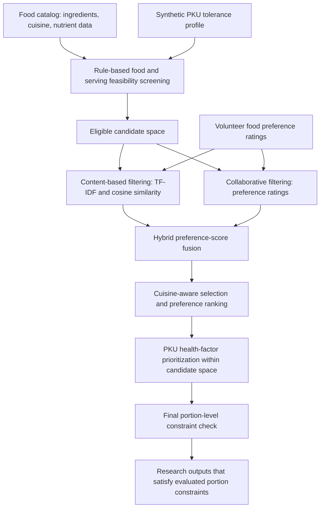
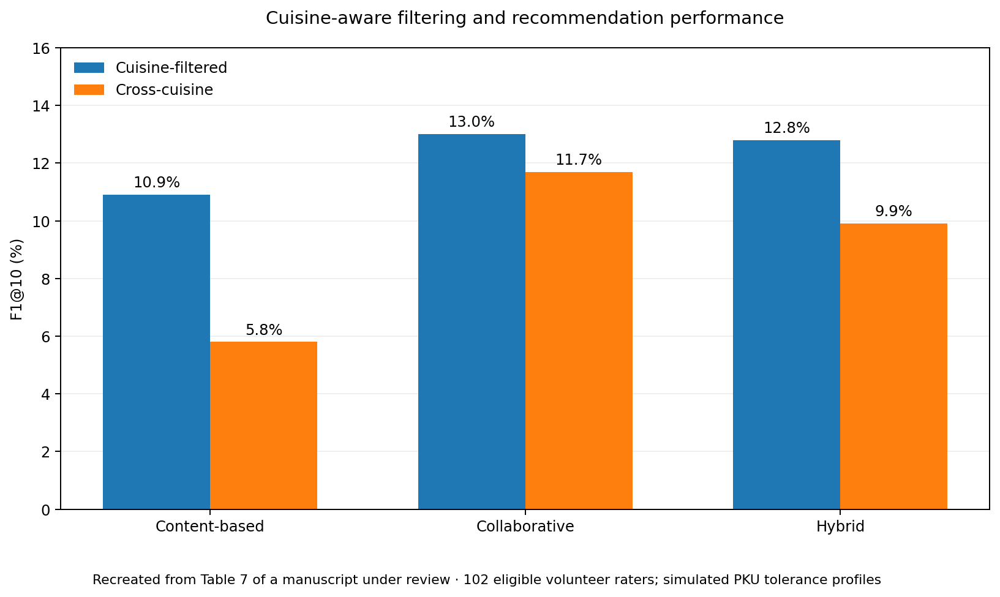

# A Safety-Constrained Hybrid Food Recommender System for Phenylketonuria: Integrating Cuisine-Aware Filtering and Clinical Rule Enforcement

**Machine Learning | Hybrid Recommender Systems | Safety-Constrained AI | Personalized Nutrition | Scientific Computing**

> **Manuscript status:** Under review at *JMIR Formative Research*.  
> **Research scope:** Prototype-level algorithmic feasibility research using food preferences from volunteers without PKU and **synthetic PKU tolerance profiles**. **Not a clinical product or dietary advice.**

## Research team

- **Malihe Aliasgari** — Kean University
- **Mardhiat Ajetunmobi** — Kean University
- **Yousef Nejatbakhsh** — Kean University (affiliation in the supplied manuscript)
- **Roya Nejatbakhsh** — University of Tehran

**Title printed in the supplied submitted manuscript:** *Safety-Constrained Hybrid Food Recommendation for Phenylketonuria Dietary Management: Algorithm Development and Simulated Feasibility Evaluation*.  
**GitHub project heading:** Uses the project title supplied by the corresponding author; confirm the final submitted journal title before making manuscript metadata public.

## Overview

This project investigates how **non-negotiable nutritional constraints** can be incorporated into a personalized food recommender, while also considering user preferences and cuisine familiarity. It addresses an important systems-design problem: recommendation quality must be evaluated **within an allowable nutritional solution space**, rather than treating all nutritional restrictions as adjustable ranking penalties.

The research integrates **collaborative filtering**, **ingredient-based content filtering**, a **hybrid preference model**, cuisine filtering, and deterministic constraints involving **phenylalanine (PHE), protein, and energy**. The focus is on **algorithm development and simulated feasibility**, not treatment decisions for real patients.

## System architecture

The safety rules are **separate from** probabilistic preference learning. The source study evaluates candidate recommendation pairs and separately counts those satisfying constraints at their evaluated portion sizes. Consequently, an initially ranked item is not automatically safe at a default serving size.

## Methodology

- **Collaborative filtering (CF):** User similarity based on Pearson correlation over co-rated foods, using preference ratings.
- **Content-based filtering (CBF):** TF-IDF ingredient representations, cosine similarity, and ingredient-based clustering.
- **Hybrid fusion:** Adaptive combination of CF and CBF predictions according to rating-history depth.
- **Cuisine-aware filtering:** Restriction of candidates to cuisines preferred in the rating history, compared with a cross-cuisine condition.
- **Hard constraint enforcement:** Simulated, profile-specific checks on PHE, protein, and energy, including portion feasibility.
- **Safety-aware ranking:** A PKU health factor used **within** the screened candidate space, not as a substitute for the hard constraints.

## Data and evaluation design

| Characteristic | Manuscript value |
|---|---:|
| Food items | 638 |
| Items with complete nutritional information | 623 (97.6%) |
| Ingredient vocabulary | 413 ingredients |
| Eligible volunteer raters | 102 |
| Raw preference ratings collected | 4,707 |
| Ratings retained after eligibility filtering | 3,193 |
| Train / test ratings | 2,485 / 708 |
| Evaluated top-K | K = 10 |

The volunteers **did not have PKU**. Their food-preference ratings were used with *simulated* tolerance profiles; the profiles were not actual patient diagnoses or measurements. A certified PKU clinical specialist reviewed simulated constraint parameters and generated dietary outputs for **plausibility**, which is **not** prospective clinical validation.

## Selected evaluation figure

*Figure 1. F1@10 across three algorithm families with and without cuisine-based filtering. Recreated from Table 7 of the submitted manuscript. These are recommendation-ranking results from a formative research dataset, not clinical outcomes.*

### Observed preference-ranking results

| Algorithm family | Cuisine-filtered F1@10 | Cross-cuisine F1@10 | Difference |
|---|---:|---:|---:|
| Content-based | 10.9% | 5.8% | +5.1 percentage points |
| Collaborative | 13.0% | 11.7% | +1.3 percentage points |
| Hybrid | 12.8% | 9.9% | +2.9 percentage points |

The **collaborative cuisine-filtered** approach had the highest observed F1@10 (13.0%), closely followed by the **hybrid cuisine-filtered** approach (12.8%). Their difference was not statistically significant in the reported paired comparison (*p* = 0.854). On the manuscript's **Liked & Safe** measure, the corresponding rates were **3.7%** and **3.6%**, respectively. These are not rates of clinical treatment success, and **Liked & Safe** should not be interpreted as the share of every generated recommendation that met its portion-level constraints.

The study also reports 5-fold user-wise cross-validation for selected models. These analyses assess stability within the study data; they do not establish generalization to actual PKU patients.

## Technical capabilities demonstrated

- Recommender-system design and evaluation
- Collaborative filtering and neighborhood similarity
- TF-IDF, cosine similarity, and ingredient-vector modeling
- Hybrid predictive modeling and adaptive weighting
- Constrained candidate selection and portion-level rule checking
- Cultural preference filtering
- Python, scikit-learn, and SciPy (as reported in the manuscript)
- Top-K ranking metrics, comparisons, and cross-validation
- Research-prototype architecture for safety-sensitive decision support

## Interpretive limits and responsible use

- **Not clinically validated:** No people with PKU were enrolled and no clinical outcomes or adherence benefits were measured.
- **No live dietary guidance:** This repository does not provide personalized PHE limits, portion prescriptions, treatment instructions, or a deployable medical tool.
- **Simulated profiles:** Nutritional constraints were evaluated using synthetic PKU profiles and a research food catalog, not real patient information.
- **Nutrient and portion checks are essential:** Food catalog eligibility alone does not guarantee safety at an arbitrary serving size; the manuscript separately evaluates portion-level feasibility.
- **Limited external validity:** Larger, prospectively recruited PKU cohorts and clinically verified data would be necessary before considering patient-facing use.

## Public repository scope

This is a **documentation and research-portfolio repository**. The following are deliberately **not** published here:

- Full original model or web-application code
- Participant preference records (consent did not cover unrestricted public release)
- Full curated food composition database or individual simulated meal plans
- Unpublished manuscript PDF and review materials
- Clinical threshold tables suitable for individual treatment decisions

The submitted manuscript states that the food dataset, synthetic profiles, and implementation may be requested from the corresponding author, while de-identified ratings require an appropriate research request and data use agreement. Any future code or data release must also respect collaborator approval and redistribution rights.

## Related research

Aliasgari, M., Li, H., Zhang, Y., Nejatbakhsh, Y., and Nejatbakhsh, R. (2024). *Recommending Healthy Food for Phenylketonuria with Collaborative and Content-Based Filtering*. IEEE HealthCom. [DOI: 10.1109/HEALTHCOM61582.2024.10801785](https://doi.org/10.1109/HEALTHCOM61582.2024.10801785).

## Contact

**Malihe Aliasgari, Ph.D.**  
[Research website](https://malihealiasgari20.github.io/) · [GitHub](https://github.com/malihealiasgari20)
